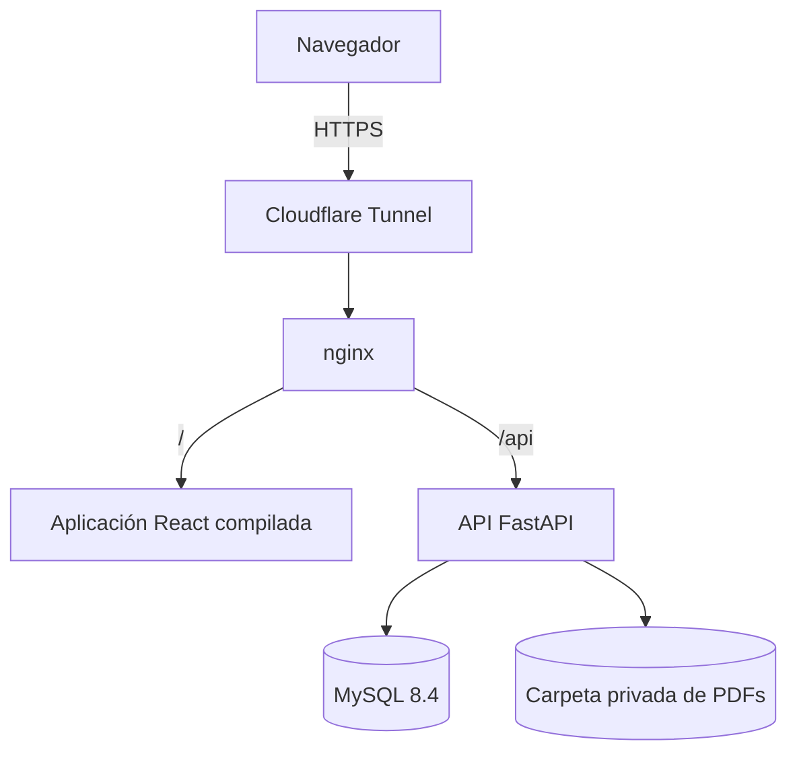
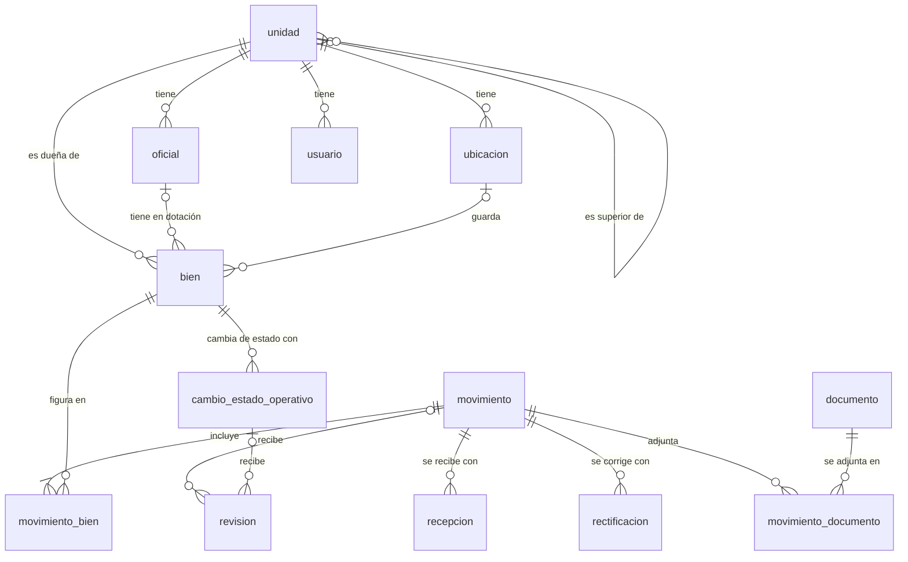

# Sistema Logístico Policial, versión 1.0

Este documento describe la versión publicada en https://logistica.nano-rodriguez.com, que corresponde al tag `v1.0.0` del repositorio. Cuenta qué hace, cómo está armada, qué cambió respecto del documento de diseño, cómo se probó y qué queda para la versión siguiente. Las historias y las reglas completas están en [historias_y_reglas.md](historias_y_reglas.md).

## Qué hace

El sistema registra quién tiene cada bien logístico que se identifica de forma individual, como armas, chalecos balísticos, móviles y equipos de comunicaciones. Cada movimiento se carga una sola vez con su acta, la unidad de destino confirma lo que recibe y el nivel superior revisa lo que registran sus unidades.

Lo usa el personal logístico de los tres niveles de la organización. Una Unidad Operacional opera y consulta solo sus bienes, una Unidad Regional suma los de sus Operacionales y la Dirección Logística ve todos. El oficial no entra al sistema y figura como responsable de los bienes que tiene en dotación.

| Área | Qué permite hacer | Historias |
|---|---|---|
| Acceso | Iniciar y cerrar sesión. Cada usuario opera según el nivel de su unidad. | HU-01, HU-02 |
| Inventario | Ver los bienes de la unidad y quién los tiene. La Regional y la Dirección ven además los de sus unidades dependientes. | HU-03, HU-04 |
| Inicio | Ver al entrar lo que espera a la unidad, de lo más antiguo a lo más nuevo, y el resumen de sus bienes. | HU-18 |
| Entregas entre unidades | Registrar una entrega de varios bienes con su acta, recibirla controlando cada bien y eligiendo dónde se guarda, o devolverla al origen para que la corrija o desista. Imprimir el acta en A4. | HU-05, HU-06, HU-16, HU-20 |
| Dotación de oficiales | Asignar bienes a un oficial de la unidad y registrar cuando los devuelve al depósito. | HU-10, HU-11 |
| Revisión y corrección | La Regional y la Dirección revisan lo que registran sus unidades, con el acta escaneada al lado, y lo aprueban u observan. La unidad corrige lo observado y cada corrección queda como una versión nueva. | HU-07, HU-08, HU-21 |
| Estado de servicio | Pasar un bien a fuera de servicio con el informe técnico en PDF, o volverlo a servicio. El cambio también se revisa y se corrige. | HU-17 |
| Documentos | Adjuntar a cada acta el PDF firmado y descargarlo con los permisos de consulta del acta. | HU-13 |
| Historial | Ver la historia de un bien en una línea de custodia con la unidad dueña, dónde estuvo o qué oficial lo tuvo y su estado de servicio, con acceso a cada acta. | HU-09, HU-19 |
| Sala de situación | La Regional y la Dirección ven por unidad y por tipo de bien cuántos están fuera de servicio y dónde se demoran las actas. | HU-22 |

## Arquitectura

Es una aplicación web con el frontend en React y una API en FastAPI armada como un monolito modular. Todo corre en contenedores Docker sobre una máquina virtual de un servidor propio, definidos en `docker-compose.prod.yml`.

- **MySQL 8.4** guarda los datos y sostiene las reglas que no pueden fallar con claves foráneas, restricciones `CHECK`, triggers y vistas. La estructura se crea con los scripts numerados de `database/migraciones` y cada cambio va en un script nuevo.
- **La API** valida cada pedido, controla los permisos, aplica las reglas y abre una transacción por operación. Cada módulo tiene un router con los endpoints, un servicio con las reglas y un repositorio con las consultas. Swagger documenta cada endpoint en `/api/docs`.
- **El frontend** en React con TypeScript, TanStack Query y Tailwind guía cada operación con los tildes de control y los avisos de cada regla. La API vuelve a validar todo lo que llega.
- **nginx** sirve la aplicación en `/`, pasa `/api` a la API y es el único contenedor que publica un puerto. **Cloudflare Tunnel** publica el sistema con HTTPS sin abrir puertos en el router.
- **Los PDFs** van a un volumen que solo monta la API, con nombres generados, y se descargan únicamente a través de ella.

| Módulo del backend | Responsabilidad |
|---|---|
| `acceso` | Inicio de sesión, usuario actual y unidades que alcanza cada usuario. |
| `organizacion` | Unidades, destinos posibles de una entrega y ubicaciones. |
| `oficiales` | Oficiales activos de la unidad. |
| `movimientos` | Entregas, recepciones, devolución al origen, corrección y desistimiento, dotaciones, devoluciones de oficiales y detalle del acta. |
| `revision` | Bandeja del superior y revisión de movimientos. |
| `cambios_estado` | Cambios de estado de servicio, su revisión y su corrección. |
| `documentos` | Carga y descarga de los PDFs de las actas. |
| `consultas` | Inventario, historial de un bien y sala de situación. |
| `core` | Configuración, conexión a la base, seguridad y formato único de los errores. |

**Seguridad.** Las contraseñas se guardan con bcrypt y la API entrega un JWT que vence a las 8 horas. En cada pedido vuelve a leer al usuario y su unidad, así que desactivar una cuenta corta el acceso en el pedido siguiente. Los permisos dependen del nivel de la unidad y la API responde 403 cuando un pedido sale del alcance del usuario, aunque la pantalla no haya ofrecido la opción. Con cada PDF verifica que sea válido, que no pase de 10 MiB y calcula su SHA-256. MySQL no expone puertos y la API se conecta con un usuario que lee y escribe datos pero no puede cambiar el esquema.

**Concurrencia.** Cada operación es una sola transacción. Al empezar bloquea los bienes con `SELECT ... FOR UPDATE` en orden de id, así dos operaciones sobre el mismo bien no se traban y la segunda espera a la primera antes de validar. Las conexiones usan READ COMMITTED para que esa segunda operación vea lo que confirmó la primera. Las revisiones y las correcciones bloquean además la cabecera del registro, y la revisión de una versión que ya cambió responde 409.

## Modelo de datos

El esquema tiene 23 tablas. El diagrama muestra las centrales. El diagrama completo, con todos los campos, está en el [documento de diseño](2da%20Entrega%20-%20Diseno%20y%20modulos%20-%20Proyecto%20Final%20-%20Grupo%20161.md).

- **La tenencia actual vive en el bien y la historia en los movimientos.** La tabla `bien` dice quién tiene cada bien ahora, con su unidad dueña y su ubicación o el oficial que lo tiene en dotación. El inventario sale de una consulta simple y el historial se arma con los movimientos y los cambios de estado.
- **Un movimiento tiene un renglón por bien.** Los renglones guardan de dónde salió y adónde fue cada bien. La recepción guarda cada respuesta del destino y, si devuelve el acta, los bienes con novedad.
- **No se borra nada.** Cada corrección queda como una versión nueva con su motivo, y cada revisión guarda la versión que vio el revisor.
- **Las reglas críticas también viven en la base.** Que un bien no esté en dos movimientos abiertos o que siempre tenga una tenencia válida lo controla la API con mensajes claros y lo vuelve a controlar la base con restricciones y triggers.
- **Jerarquía estricta.** Una Operacional solo depende de una Regional y una Regional solo de la Dirección. Lo controla una clave foránea compuesta sobre el nivel de la unidad superior.

## Decisiones

| ADR | Decisión |
|---|---|
| [0001](decisiones/0001-read-committed.md) | Las conexiones usan READ COMMITTED para que una operación concurrente valide con lo que confirmó la otra. |
| [0002](decisiones/0002-base-de-pruebas-con-los-scripts.md) | La base de pruebas se crea con los mismos scripts que el servidor, con sus triggers y restricciones. |
| [0003](decisiones/0003-vaciado-con-truncate.md) | Las pruebas confirman sus datos y entre una y otra se vacían las tablas con `TRUNCATE`. |
| [0004](decisiones/0004-scripts-con-el-cliente-mysql.md) | Los scripts SQL se ejecutan siempre con el cliente `mysql`, porque usan `DELIMITER`. |
| [0005](decisiones/0005-bcrypt-y-jwt.md) | Contraseñas con bcrypt y sesión con un JWT de 8 horas. |
| [0006](decisiones/0006-numero-de-orden-por-bien.md) | Cada bien tiene un número de orden de lo aplicado que la base aumenta con triggers. |
| [0007](decisiones/0007-revision-de-la-version-vigente.md) | Una revisión vale solo para la versión que vio el revisor. |
| [0008](decisiones/0008-actas-anteriores-de-un-bien.md) | Quien tiene hoy un bien puede abrir las actas anteriores en las que figura. |
| [0009](decisiones/0009-unidad-del-oficial.md) | La unidad de un oficial solo cambia con un traslado confirmado que incluya todos sus bienes. |
| [0010](decisiones/0010-correccion-de-actas-devueltas.md) | Los bienes y el destino de un acta devuelta se corrigen sobre la misma acta. |

## Qué cambió respecto del documento de diseño

| Cambio | Por qué |
|---|---|
| Número de orden por bien, versión revisada y jerarquía estricta, en el script 002. | La fecha del hecho guarda solo el día, y en un mismo día un bien puede entregarse, recibirse y quedar en dotación. La revisión tenía que quedar atada a una versión para saber qué se aprobó. ADR 0006 y ADR 0007. |
| Trigger que impide cambiar la unidad de un oficial fuera de un traslado, e informe obligatorio en las correcciones de un fuera de servicio, en el script 003. | La clave foránea del oficial con `ON UPDATE CASCADE` movía sus bienes de unidad sin dejar historial. Toda versión de un fuera de servicio tiene que tener su informe. ADR 0009. |
| Devolución del acta al origen, en el script 004. | En el diseño el destino solo aceptaba o rechazaba. Cuando el papel no coincide con el sistema, el origen tiene que poder corregir el acta, y mientras tanto los bienes no pueden quedar libres. HU-16. |
| Los bienes y el destino de un acta devuelta se corrigen sobre la misma acta. | La rectificación guarda número, fecha y descripción pero no los renglones. Como el acta todavía no se aplicó, no se pierde historial de los bienes. ADR 0010. |
| Historias nuevas para el uso diario. | Después del diseño se sumaron el inicio con los pendientes, la línea de custodia, la impresión del acta, el acta escaneada al lado de la revisión y la sala de situación, para que cada nivel encuentre lo que tiene que hacer sin buscarlo. HU-18 a HU-22. |
| Los cambios de estado tienen su propio módulo y los oficiales también. | El módulo de bienes del diseño incluía el alta de bienes, que quedó para después, y los cambios de estado pasaron a ser una historia propia, la HU-17. Los oficiales se consultan aparte porque los usan la dotación y la devolución. |
| La sala de situación en lugar de los reportes. | Cubre la parte de los reportes que más se usa, el estado de servicio por unidad y las actas demoradas. Los reportes exportables quedan para la versión siguiente. |
| Traslados, anulaciones, reubicación, bajas, alta de bienes y administración quedaron fuera de la aplicación. | Se priorizó el circuito completo de una entrega, con recepción, revisión, corrección e historial, y después lo que una unidad usa todos los días. El resto se recortó según la línea de corte del plan. |

## Cómo se probó

Las pruebas automáticas cubren la API y la base de datos. Corren con pytest contra un MySQL 8.4 real, creado con los mismos scripts que el servidor y separado de la base de desarrollo. Una base en memoria no tiene los triggers, las restricciones ni el bloqueo de filas, y las pruebas hubieran pasado sin probar las reglas.

- **Pruebas de la API por historia.** Cada criterio de aceptación tiene al menos una, con el caso correcto y los errores que correspondan, un 403 fuera del alcance, un 409 por conflicto o un 422 por datos inválidos.
- **Pruebas del esquema con SQL directo.** Comprueban que la base rechaza lo que no puede pasar aunque la API fallara, como una jerarquía inválida o un cambio de unidad de un oficial sin traslado.
- **Pruebas de concurrencia.** Lanzan dos operaciones a la vez en hilos con conexiones distintas y verifican que solo una se aplica y la otra espera o responde 409.
- **Pruebas de versiones.** Comprueban que cada corrección queda como una versión nueva y que la revisión de una versión que ya cambió responde 409.
- **Recorrido completo.** Una prueba recorre la entrega de A a B desde el registro hasta el historial, pasando por la observación y la corrección.
- **Documentación de la API.** Una prueba falla si un endpoint no tiene descripción, ejemplo y errores en Swagger.

| Regla | Cómo se comprueba | Prueba |
|---|---|---|
| Dos usuarios no pueden mover el mismo bien al mismo tiempo. | Dos entregas simultáneas del mismo bien. La segunda espera a la primera y responde 409, y queda una sola acta. | `test_dos_entregas_simultaneas_del_mismo_bien_registran_una_sola` |
| Un acta se recibe una sola vez. | Dos recepciones simultáneas de la misma acta. Solo una se aplica. | `test_dos_recepciones_simultaneas_de_la_misma_acta_aplican_una_sola` |
| Una revisión vale solo para la versión que vio el revisor. | Se corrige el acta después de que la Regional la abrió. La revisión de la versión anterior responde 409 y el acta guarda cada versión. | `test_la_revision_de_una_version_vieja_responde_409_y_el_acta_guarda_cada_version` |
| Una revisión y una corrección simultáneas no se cruzan. | Dos sesiones en hilos. La segunda espera a que la primera confirme. | `test_una_revision_espera_la_rectificacion_en_curso_del_movimiento` |
| La jerarquía es estricta. | La base rechaza una Operacional que depende de otra Operacional. | `test_una_operacional_que_depende_de_otra_operacional_es_rechazada` |
| La unidad de un oficial cambia solo con un traslado. | La base rechaza el cambio directo de un oficial con bienes. | `test_un_oficial_con_bienes_no_cambia_de_unidad_sin_traslado` |
| Un bien no recibe dos cambios de estado a la vez. | Dos cambios simultáneos del mismo bien. Solo uno se aplica. | `test_dos_cambios_simultaneos_del_mismo_bien` |
| Un PDF no se carga dos veces. | Dos cargas simultáneas del mismo archivo guardan un solo documento. | `test_dos_cargas_simultaneas_del_mismo_pdf_guardan_un_solo_documento` |

La versión tiene 379 pruebas automáticas en verde y una cobertura del 99% del código de la API. Corren en GitHub Actions en cada pull request junto con los linters, y `main` no acepta un cambio si alguna falla. La sección Pruebas del [README](../README.md#pruebas) explica cómo repetirlas.

El frontend no tiene pruebas automáticas. Cada pantalla se probó en el navegador contra sus criterios de aceptación, y antes de publicar la versión se hizo el [recorrido de aceptación](recorrido_de_aceptacion.md) con cada usuario de demostración en el sistema publicado, en una computadora y en un celular. Aparecieron dos fallas. Las fechas de los cambios de estado registrados después de las 21 h figuraban con el día siguiente en el historial y en la bandeja, y se corrigió con el script `005_fechas_en_hora_argentina.sql` y su prueba. La otra, que en el celular algunas pantallas se corren de costado, quedó entre las limitaciones.

## Qué queda para la versión siguiente

En orden de prioridad:

1. Exigir el PDF del acta para aceptar una entrega y permitir reemplazar un documento cargado por error sin perder el original.
2. Traslados de oficiales con sus dotaciones. La tabla y el trigger ya están en la base, falta definir cómo se anula un traslado confirmado y hacer la API y las pantallas.
3. Anulación de actas y de cambios de estado, sobre las columnas y los triggers que ya tiene el esquema.
4. Alta de bienes, baja y reubicación dentro de la unidad. Hoy los bienes se cargan con el script de datos de demostración.
5. Administración de usuarios, unidades, oficiales y ubicaciones.
6. Reportes exportables que reemplacen el parte mensual y estadísticas de disponibilidad.
7. Pruebas automáticas de las pantallas.

Limitaciones conocidas de esta versión:

- El PDF del acta no es obligatorio. Una entrega se puede recibir y revisar sin él y la revisión avisa que falta.
- Al corregir un acta devuelta no queda cómo eran los renglones antes del reenvío. Quedan las devoluciones con su motivo y los bienes con novedad.
- El acta impresa muestra el estado actual de cada bien y no el que tenía al registrarse.
- Cerrar sesión borra el token del navegador, pero el token sigue valiendo hasta que vence.
- Los PDFs no se reemplazan ni se borran.
- En el celular, la página de Revisión y las ventanas para recibir un acta y para corregirla se pueden correr de costado hasta un espacio vacío. Se ven completas y las acciones funcionan. Está en el issue #85.
- Entre las 21 y las 24 h, la fecha del hecho de un movimiento acepta el día siguiente, porque la API la compara con el día del servidor, que está en UTC.
- El sistema corre en un solo servidor y su disponibilidad depende de ese equipo y de su conexión.
